# KarSaathi — agentic GST co-pilot for micro enterprises

**LLMs read. Rules decide. Humans approve.**
SIH 2026 · Problem: *Micro enterprises lose time and profit to compliance paperwork* · Category: Agentic AI

The owner forwards bills on WhatsApp. The agent reads them (signed e-invoice QR first, then OCR, then Claude), books them, checks suppliers, e-way bills and cash, and prepares the return with a plain-language summary in Kannada, Hindi or English. A versioned rule engine does every tax calculation. The owner prepares, the accountant checks and signs, and only then does the **simulated** filing run. The agent never files on its own.

## Screenshots

### Landing page (3D, scroll-driven)

As you scroll, the 3D bills go from a messy bag → sorted piles → one return → stamped by a human.

| | |
|---|---|
| 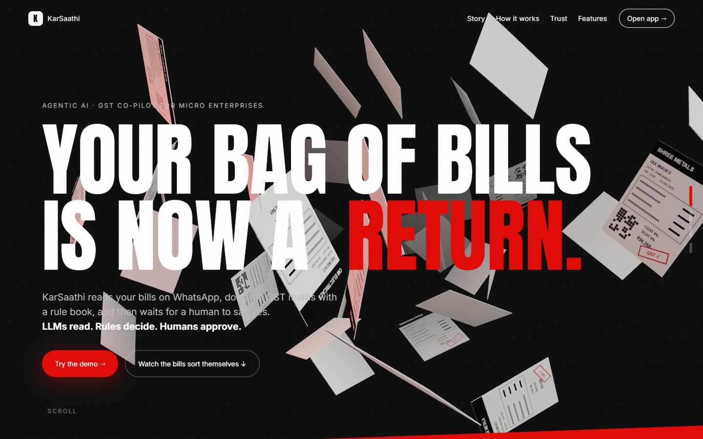 | 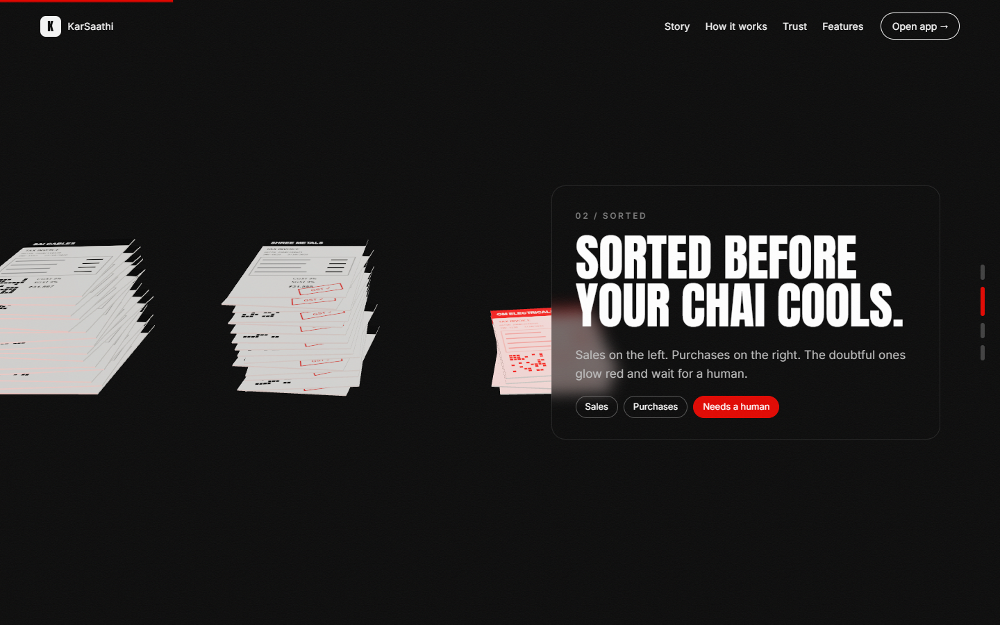 |
| 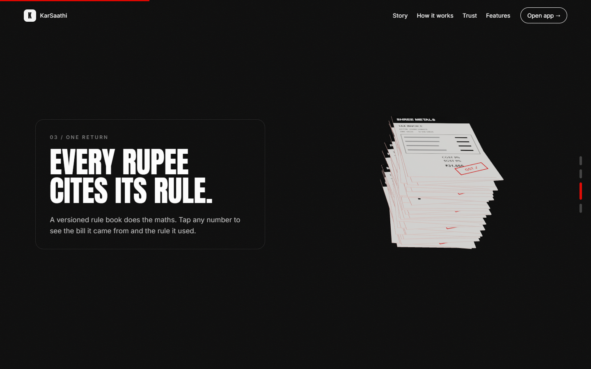 | 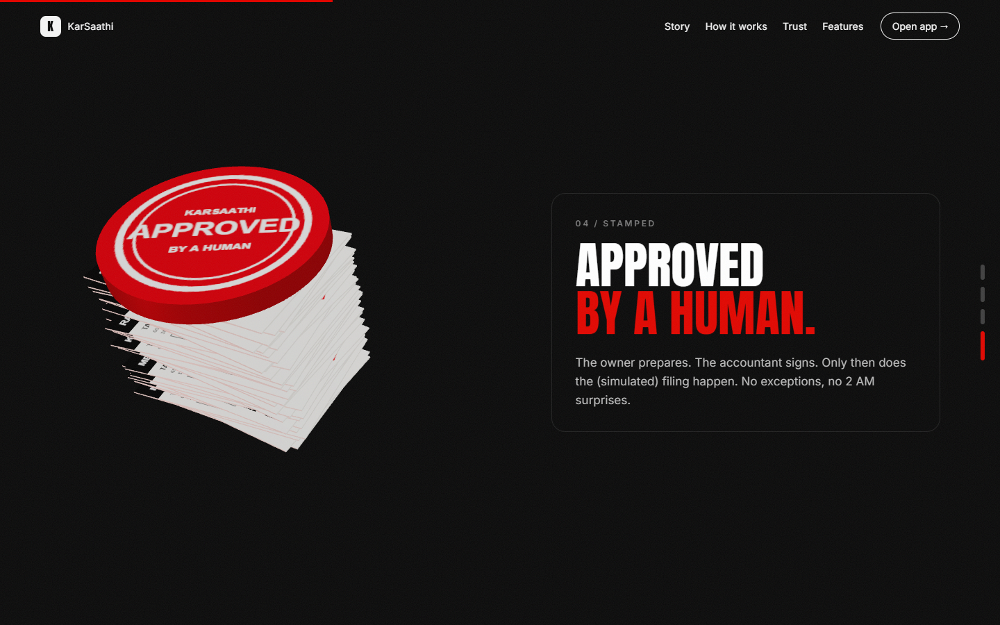 |
| 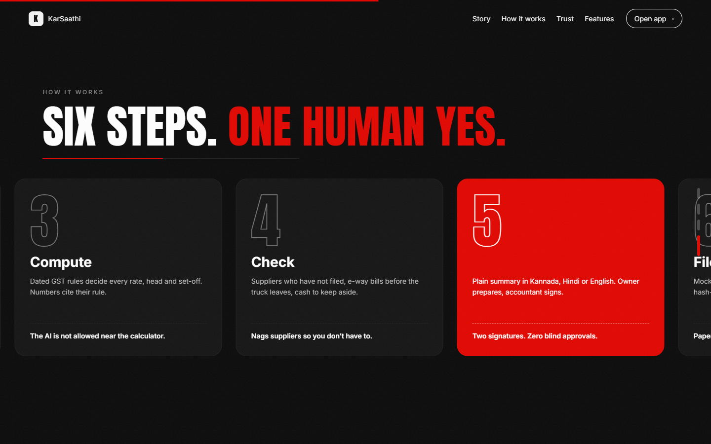 | 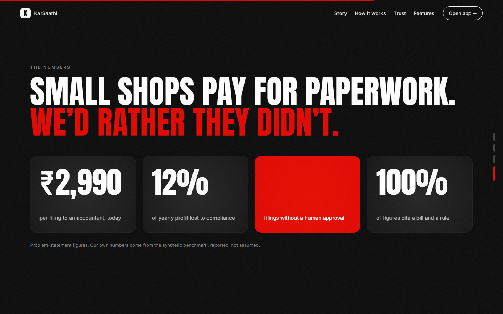 |

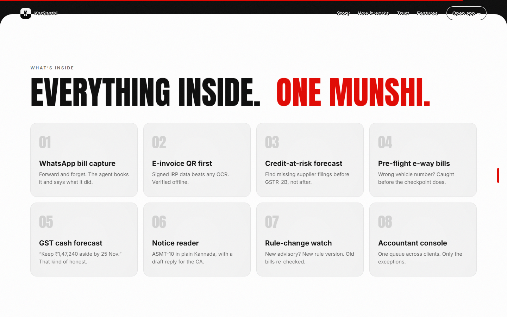

### The app

| | |
|---|---|
| 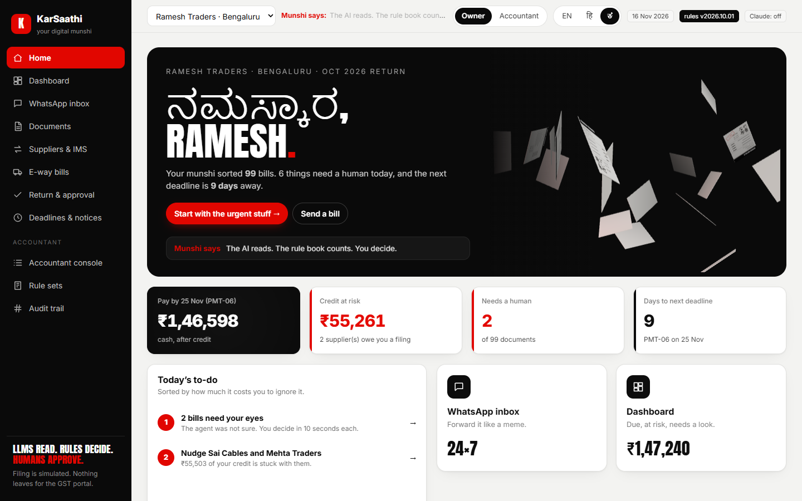 | 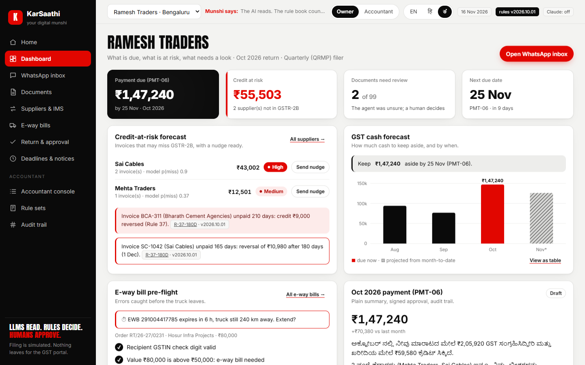 |
| 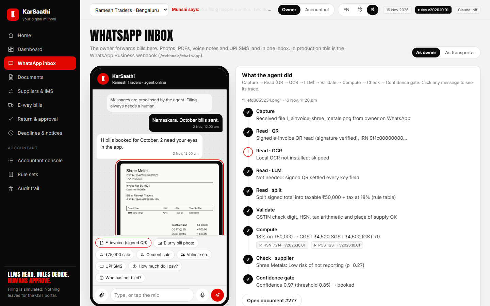 | 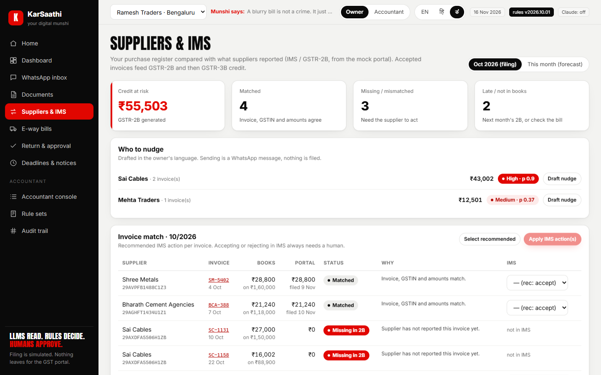 |
| 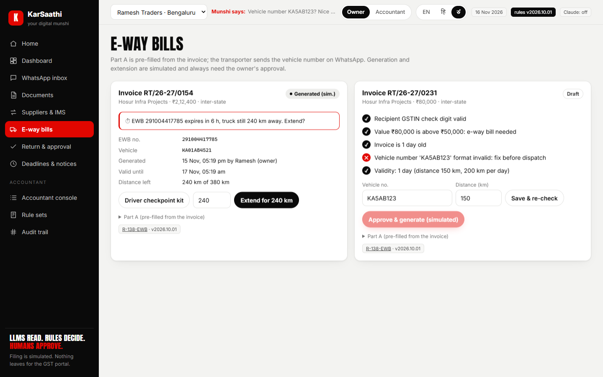 | 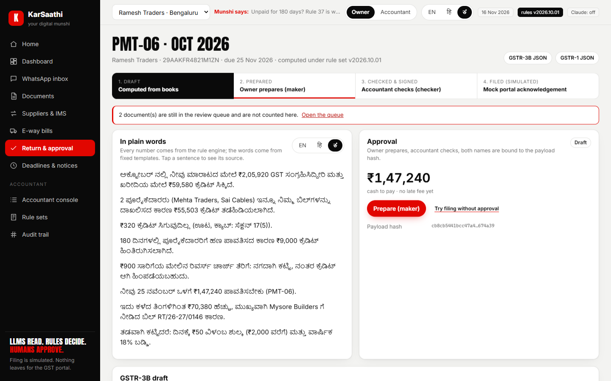 |

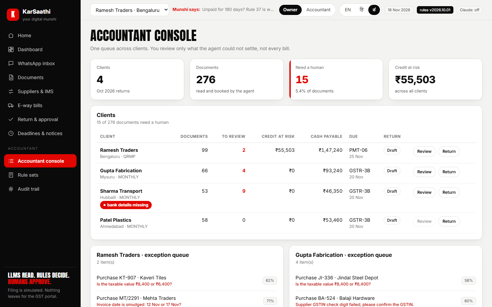

### Mobile

<p>
  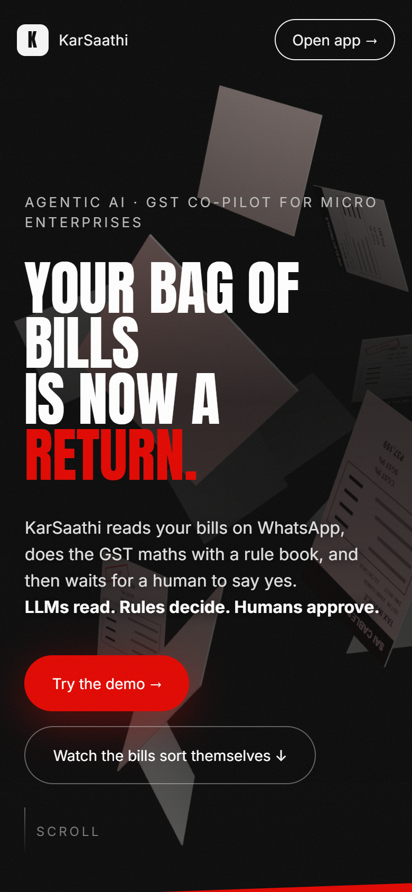
  &nbsp;
  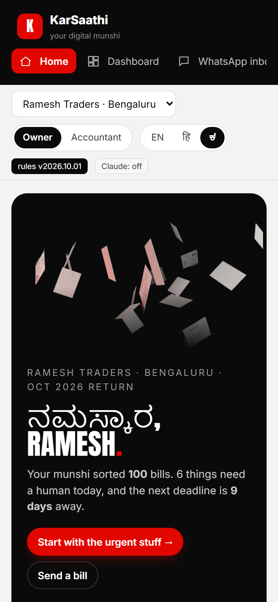
</p>

## Run it

```powershell
.\run.ps1            # installs, seeds demo data, builds the UI, serves http://127.0.0.1:8000
.\run.ps1 -Reseed    # reset the demo
.\run.ps1 -Dev       # API on :8000 + Vite dev server on :5173
```

Needs Python 3.12 and Node 20+. To let Claude read photos, notices and advisories, and answer questions, set `ANTHROPIC_API_KEY` (model `claude-opus-5-5`; override with `KARSAATHI_MODEL`). Without a key, every path still works. Signed QR and text are read deterministically, doubtful photos go to the review queue, and notices use a fixed form table.

The demo clock is pinned to **16 Nov 2026** (`KARSAATHI_TODAY`), so the October return, the 25 Nov PMT-06 and the e-way bill timers line up. Tests: `cd backend; python -m pytest -q`.

## 4-minute demo script

| # | Where | What to show |
|---|-------|--------------|
| 1 | **WhatsApp inbox** → *E-invoice (signed QR)* | Signature verified, no LLM needed, taxable split from the rule rate, booked at 97% confidence. Right panel shows each pipeline step with rule citations. |
| 2 | *Blurry bill photo* | No QR, no OCR: Claude reads it, or (without a key) it goes to the review queue with a question. |
| 3 | **Suppliers & IMS** | ₹55,503 credit at risk: Sai Cables (High, p=0.9) and a Mehta Traders amount mismatch. Draft a nudge in Kannada → *Open in WhatsApp*. Accepting/rejecting in IMS asks for approval. |
| 4 | WhatsApp → *₹75,000 sale*, then switch **As transporter** → *Vehicle no.* | E-way bill Part A pre-filled, transporter asked, pre-flight passes. **E-way bills**: approve & generate (simulated), see the 6-hour expiry alert, extend, open the driver's checkpoint kit. |
| 5 | **Rule sets** → *Read advisory → propose* → approve | Simulated advisory: tiles 18% → 5% from 1 Nov. New version v2026.11.01 is published, and the 3 November tile invoices are re-run and flagged. |
| 6 | **Return & approval** (language ಕ) | Plain summary in Kannada; tap a sentence → source bills. *Try filing without approval* → blocked and logged. Owner: *Prepare*. Switch to Accountant: *Check & sign* (maker ≠ checker enforced). *File (simulated)* → ARN. |
| 7 | **Audit trail** → *Verify chain* · **Accountant console** | Every action hash-chained. One exception queue across 4 clients. |

## How the deck maps to code

| Deck box | Code |
|---|---|
| Inputs: WhatsApp bills, e-invoice QR, UPI SMS | `agent.process_inbound`, `reader.py`, Twilio webhook `POST /webhook/whatsapp`, in-app simulator |
| Read: QR → OCR → LLM | `reader.read_bill` (OpenCV QR + RS256 JWT verify → Tesseract if installed → Claude structured output with per-field confidence) |
| Validate | `validators.py` (GSTIN mod-36 check digit, arithmetic, place of supply), `engine.find_duplicate` |
| Rule engine: dated rules, cites the rule | `rulesets/v*.yaml`, `rules.py` (each lookup returns value + rule id + version) |
| Agent checks: credit at risk, e-way pre-flight, cash | `engine.reconcile` + `engine.supplier_risk`, `ewaybill.preflight/watch`, `engine.cash_forecast`, `engine.ageing` (Rule 37) |
| Confident? No → review queue | `agent._gate_confidence` (threshold in the rule file) |
| Maker–checker, signed approval | `approvals.py` (HMAC over payload hash + both names; tamper → invalid) |
| Agent: allow-listed tools only | `agent.gate`: safe tools vs gated `file_return`, `ims_action`, `generate_ewb`; Claude Q&A gets read-only tools only |
| Output: return draft, plain summary, simulated filing, audit log | `engine.compute_3b` (Rule 88A set-off), `gstr3b_json`, `gstr1_json`, `summary.py`, `portal.py` (mock portal, fake ARN), `audit.py` (hash chain) |
| Notice & rule-change reader | `notices.py`, `rulewatch.py` |

## Guardrails

- The model never produces a tax figure. Claude's outputs are bill fields, notice explanations and advisory parsing, each checked by code. Summaries are fixed templates filled with engine numbers.
- Every figure is traceable: return rows and summary sentences open their source bills, and each bill shows its image, read method and confidence per field, and rule citations.
- Three actions always need a human: filing, IMS accept/reject, e-way bill generation/extension. Blocked attempts are written to the audit log.
- Rules are data: a change ships as a new YAML version after approval; past invoices are re-run.
- The GST portal is mocked (`/portal/*`). No real portal calls, no real taxpayer data; all businesses are fictional.

## Honest notes

- The HSN rate table is a small demo table; verify each rate against the current CBIC notification. TDS rules use legacy section labels (194C/194J) and need mapping to the Income-tax Act, 2025.
- The supplier risk model uses hand-set logistic weights on synthetic histories; the deck's plan is to fit it on the 150–200-bill synthetic benchmark.
- The Claude paths (photo reading, notice explanation, Q&A agent) were not exercised in local testing because no API key was set; the no-key fallbacks were.
- The Dockerfile and `docker-compose.yml` (PostgreSQL) were not run here because Docker isn't installed on this machine.
- Languages: English, Hindi and Kannada. Next: Bengali, Telugu, Marathi, Tamil, Urdu, Gujarati, Malayalam, Odia, Punjabi and Assamese. Add each to `backend/app/i18n.py`, the strings in `summary.py`/`notices.py`, and `LANGS` in `frontend/src/App.jsx`.

## Layout

```
backend/app/   main.py (API) · agent.py · reader.py · llm.py · engine.py · rules.py · rulesets/ · validators.py
               ewaybill.py · approvals.py · audit.py · portal.py (mock) · summary.py · notices.py · rulewatch.py · seed.py
backend/tests/ rule-engine tests
frontend/src/  App.jsx · ui.jsx · pages/ (Overview, WhatsApp, Documents, Suppliers, EwayBills, Return, Deadlines, Rules, Audit, Console)
```
